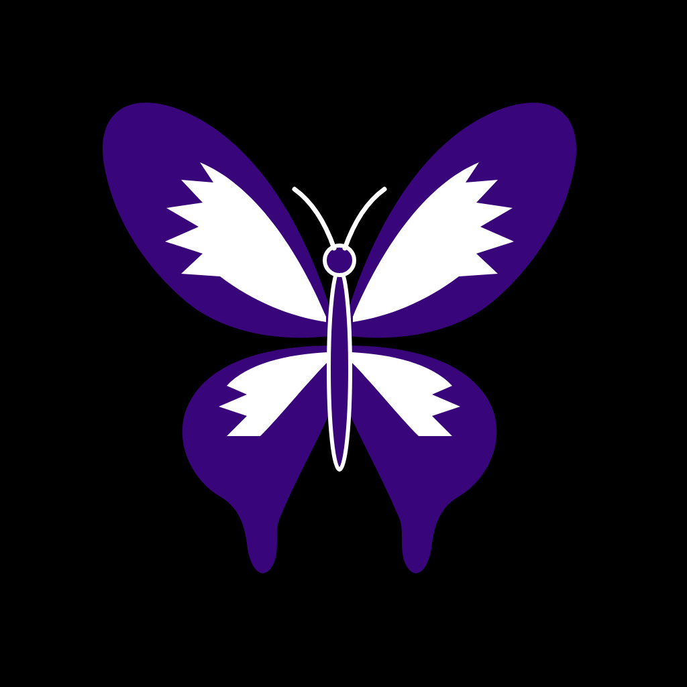
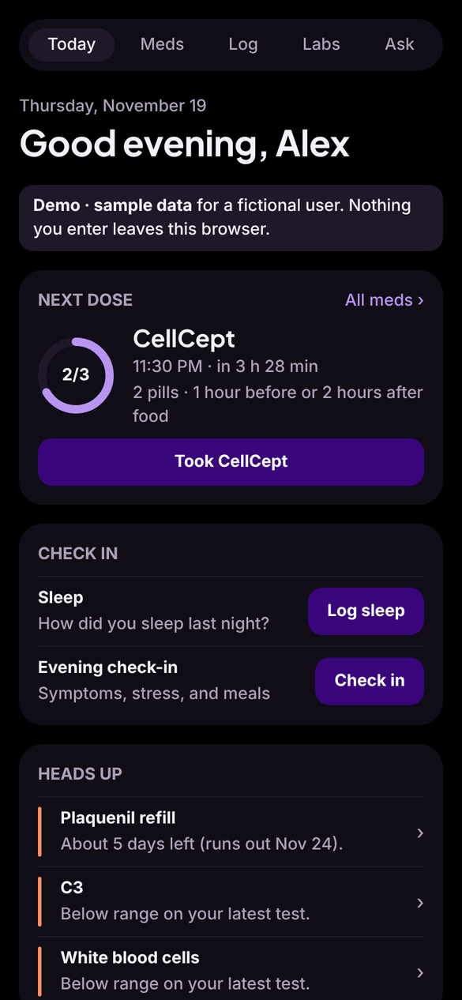
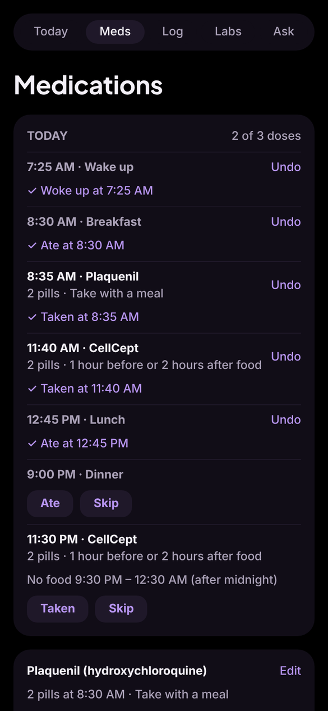
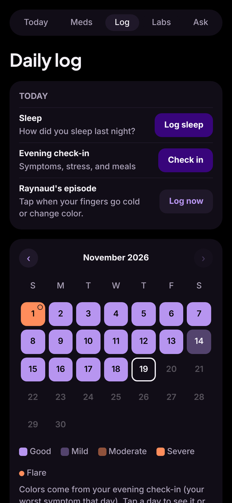
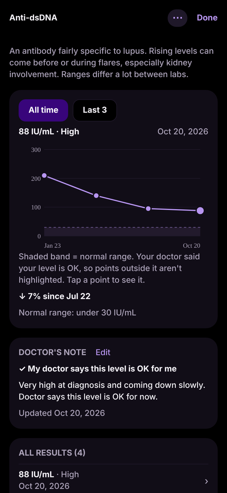
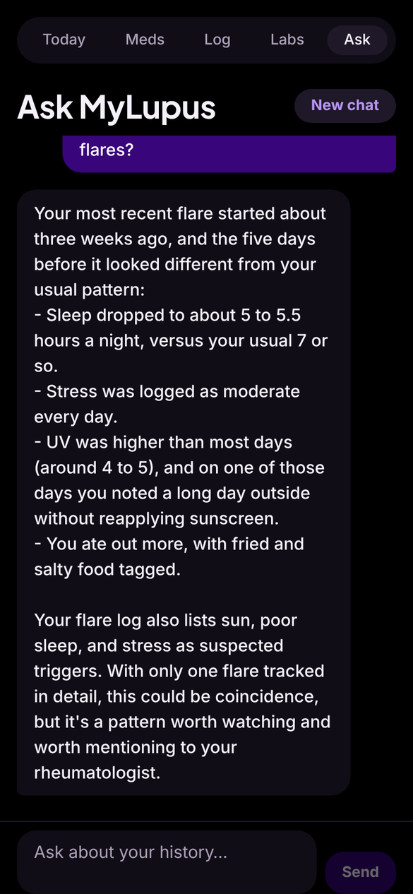
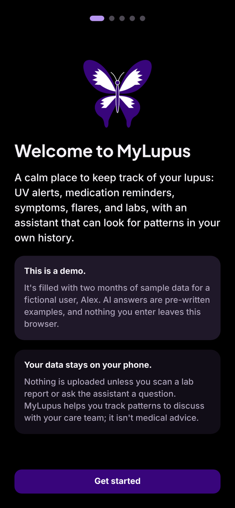

<p align="center">
  
</p>

<h1 align="center">MyLupus</h1>

<p align="center">
  A personal companion app for living with lupus: UV alerts, medication reminders that adapt to your day,
  symptom and flare tracking, lab trends, and an AI assistant that answers questions from your own history.
</p>

<p align="center">
  <a href="https://pghosh-101.github.io/mylupus/"><b>Try the live demo →</b></a><br/>
  <sub>The demo uses sample data for a fictional user and pre-written AI examples. No API keys, nothing leaves your browser.</sub>
</p>

<p align="center">
  
  
  
</p>
<p align="center">
  
  
  
</p>

## Why

Lupus looks different for everyone, and the information that matters most (your symptoms, triggers, labs, and how they relate) is usually scattered across notes, patient portals, and memory. MyLupus keeps it in one place and helps you spot your own patterns to discuss with your care team.

## Features

**Sun protection.** Live UV for your location, an hourly forecast, a personal UV limit, an 8 AM notification with today's peak and the hours above your limit, and sunscreen reapply reminders that only fire if UV is still high. Mark "Staying in today" (or a past day as stayed inside) so indoor days don't count as days without sunscreen.

**Medications that adapt to your day.** Food rules (with food / empty stomach), spacing between medications, and a daily routine (wake, meals, bed). Log when you actually woke up, ate, or took a dose, and the rest of the day re-plans itself in either direction: items in the next few hours shift to keep your usual gaps (earlier by up to an hour), safety rules always win, and each dose shows the earliest time it's OK to take. Reminders repeat at 1 and 2 hours until a dose is logged, and later doses wait for the one before. A "Missed doses" list catches unlogged doses from the last two days, such as a late dose that rolled past midnight. Refill reminders before you run out.

**Daily log.** A 30-second morning sleep check-in and evening check-in (symptoms, stress, meals, notes, plus symptoms you add yourself), a month calendar colored by how each day went, Raynaud's episodes with the outdoor temperature, and a weekly pattern report computed on the device that compares against what was actually due so far ("On track", "A little behind"). One "Update history" sheet logs current or past flares (with rough lengths like "about a week") and your health background, and "View history" shows them as an expandable timeline by year.

**Labs.** Scan a lab report photo or type results in. Charts over time with normal ranges, change since the last test, and doctor's notes (for example, "this level is OK for me," which turns off warnings while still flagging a real worsening).

**Learn: News and Library.** A live research feed: new lupus studies from PubMed (with Europe PMC for citation counts; each backs up the other), research news from the Lupus Research Alliance, and recruiting clinical trials near you from ClinicalTrials.gov. Filter by type, topic, time (last month, last year, all time) and sort by newest, most cited, or best match. Items that mention your medications or conditions are marked, and "Explain this study" gives a plain-English summary of the abstract. The Library is a hand-picked, link-checked set of articles from Johns Hopkins, HSS, the American College of Rheumatology, the Lupus Foundation of America, NIH MedlinePlus, and Cleveland Clinic, filterable by topic, source, and length, with a Saved list for appointments. First-time setup asks which topics you care about.

**Ask MyLupus.** A chat assistant that answers questions from your logged history ("What tends to come before my flares?", "Summarize the last 3 months for my rheumatologist"), and searches reputable medical sources for general questions, with citations.

## How the AI works

- **Lab report scanning** sends the photo to Claude (Haiku) with a JSON schema, then shows every value on a review screen before anything is saved.
- **The assistant** uses Claude (Sonnet) with a snapshot of the user's data taken when a chat starts. The snapshot and system prompt are fixed per conversation and cached, earlier turns are sent back unchanged, and web search is enabled only for new chats.
- **Guardrails:** answers cite the user's own dates and numbers, describe patterns as correlations rather than causes, respect doctor's notes, never diagnose or change medications, and put warning signs first.

## Privacy and security

- All health data is stored **on the device**. Nothing is uploaded except a lab photo you choose to scan or a question you choose to ask.
- **Export my data** saves everything to one JSON file through the share sheet (Files, iCloud Drive), and **Restore from a backup** loads it back, so a new phone or reinstall doesn't lose your history. The file only goes where you choose to save it.
- API keys live in a local `.env.local` file that is **never committed**, and every `.env` variant is git-ignored.
- The **public demo** is built with `EXPO_PUBLIC_DEMO=1` and with `.env` loading disabled, and the build script scans the output and refuses to publish if anything key-like is found. Demo AI answers are pre-written, so the demo makes no API calls.

## Tech

React Native + Expo (Expo Router, SDK 58), TypeScript, React Compiler, `react-native-svg` charts, local notifications, `expo-location`, AsyncStorage, the Claude API (via HTTPS), WeatherAPI.com and Open-Meteo for UV, PubMed and Europe PMC, ClinicalTrials.gov, and the Lupus Research Alliance feed.

## Run it yourself

```bash
npm install
cp .env.example .env.local   # then add your own keys (optional)
npx expo start
```

Scan the QR code with Expo Go on your phone. Without keys, everything works except lab scanning and the assistant; UV falls back to Open-Meteo.

Build the public demo (outputs `dist-demo/`):

```bash
npm run build:demo
```

## Disclaimer

MyLupus helps track patterns to discuss with a care team. It is not medical advice and does not diagnose or recommend treatment.
